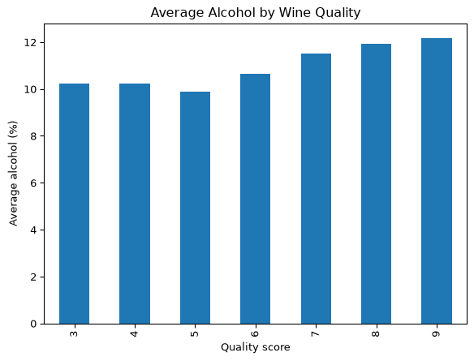

# Wine Quality Data


``` python
## Wine Quality: Data Wrangling Final Project
# winequality-red.csv and winequality-white.csv
## Overview
## This project analyzes datasets containing physicochemical properties and quality ratings for red and white variants of the Portuguese *Vinho Verde* wine. The goal is to clean and merge the datasets to explore how key features—specifically alcohol content—relate to wine quality across different wine types.

## The analysis begins by loading separate CSV files for red and white wines, labeling each dataset with its respective type, and combining them into a single pandas DataFrame.

import pandas as pd
import matplotlib.pyplot as plt

red = pd.read_csv("winequality-red.csv", sep=";")
white = pd.read_csv("winequality-white.csv", sep=";")

# shape 
print("Red wines:", red.shape)
print("White wines:", white.shape)

# new column to tell the wines apart 
red["wine_type"] = "red"
white["wine_type"] = "white"

# stacking red and white wine tables
wine = pd.concat([red, white])
print("Combined:", wine.shape)

# fix column names
wine.columns = wine.columns.str.replace("red", "white")
print(list(wine.columns))

# duplicate
print("Duplicate rows:", wine.duplicated().sum())
# Removing
wine = wine.drop_duplicates()
print("After removing duplicates:", wine.shape)

# grouping wines by quality score, and finding the average alcohol in each group
average_alcohol = wine.groupby("quality")["alcohol"].mean()
print(average_alcohol)

# Plotting the comparative analysis
ax = alcohol_by_type.plot(kind="bar", figsize=(8, 5))
plt.title("Average Alcohol Content by Quality and Wine Type")
plt.xlabel("Quality Rating")
plt.ylabel("Average Alcohol (%)")
plt.legend(title="Wine Type")
plt.tight_layout()
plt.savefig("alcohol_vs_quality_by_type.png")
plt.show()


# comparing average alcohol content between Red and White wines
alcohol_by_type = wine.groupby(["quality", "wine_type"])["alcohol"].mean().unstack()

# bar chart
average_alcohol.plot(kind="bar")
plt.title("Average Alcohol by Wine Quality")
plt.xlabel("Quality score")
plt.ylabel("Average alcohol (%)")
plt.savefig("alcohol_vs_quality.png")  
plt.show()                             # chart
```

    Red wines: (1599, 12)
    White wines: (4898, 12)
    Combined: (6497, 13)
    ['fixed acidity', 'volatile acidity', 'citric acid', 'residual sugar', 'chlorides', 'free sulfur dioxide', 'total sulfur dioxide', 'density', 'pH', 'sulphates', 'alcohol', 'quality', 'wine_type']
    Duplicate rows: 1177
    After removing duplicates: (5320, 13)
    quality
    3    10.215000
    4    10.215049
    5     9.872211
    6    10.649060
    7    11.511020
    8    11.912162
    9    12.180000
    Name: alcohol, dtype: float64


